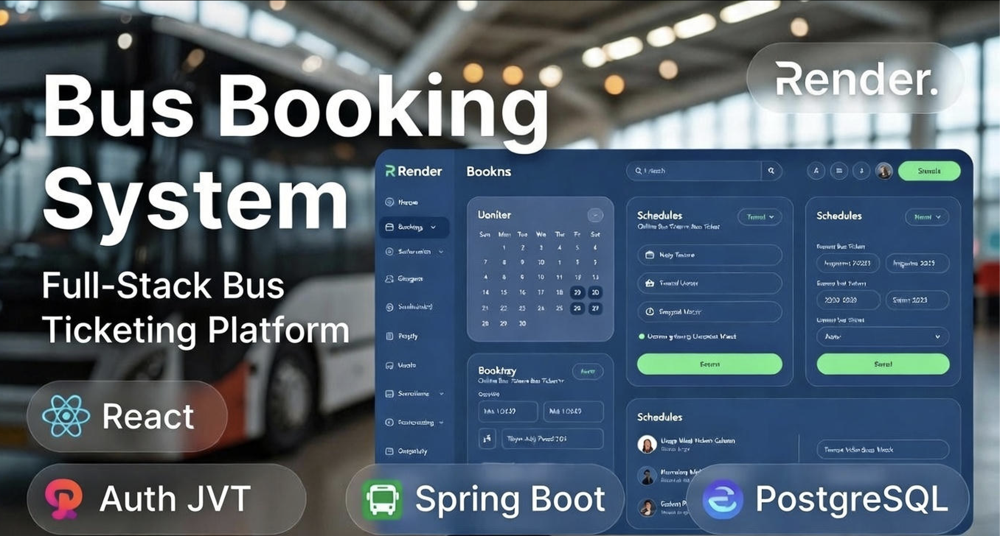
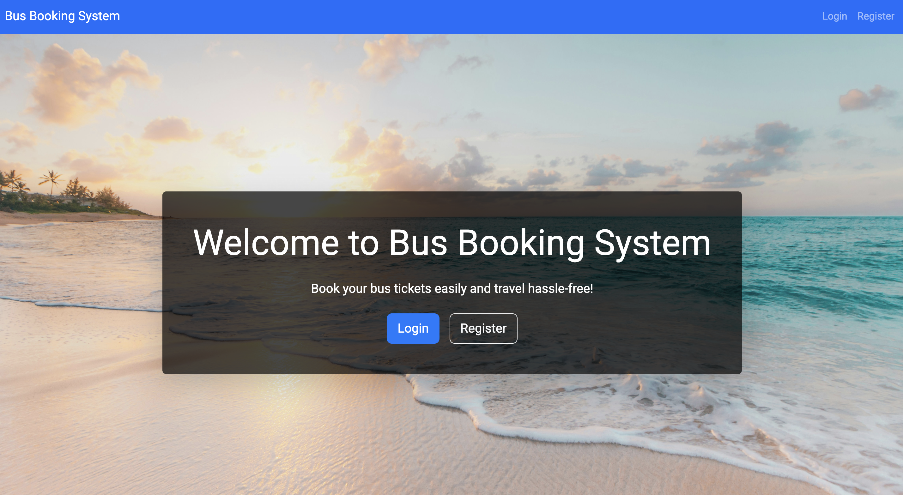
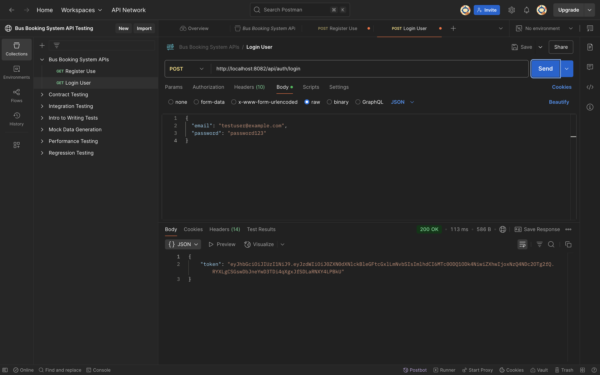
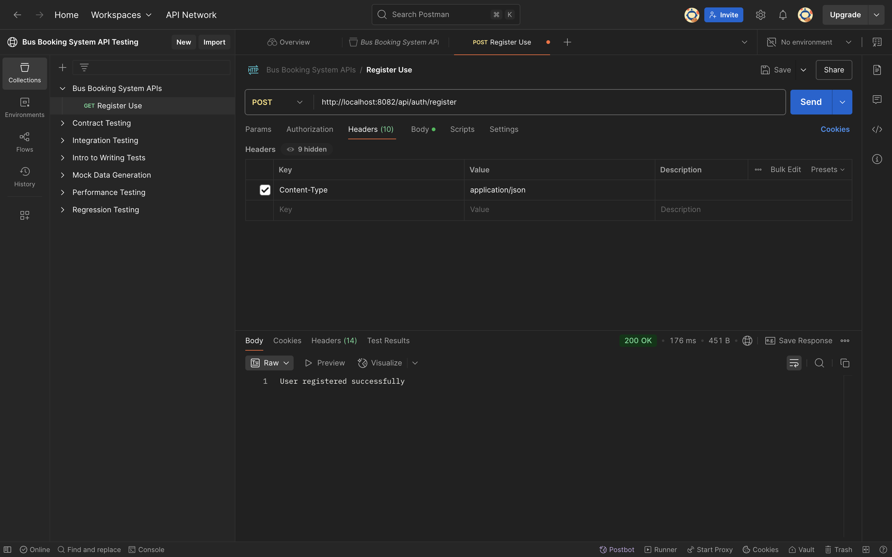
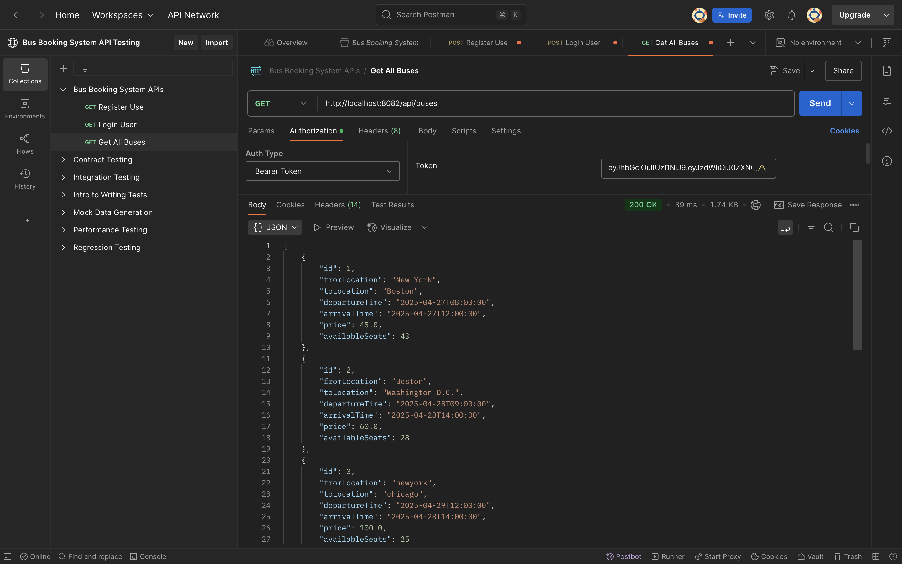
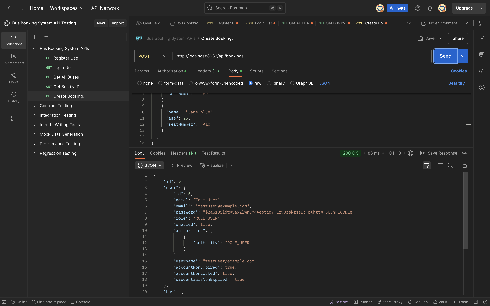

<p align="center">
  
</p>

A modern bus reservation platform built using **React**, **Spring Boot**, and **PostgreSQL / H2**, designed with a layered backend architecture and a responsive user interface.

<p align="center">
  
  
  
  
  
  
</p>

A bus reservation platform built using **React**, **Spring Boot**, and **PostgreSQL** and modern engineering principles, modular backend architecture, and a clean scalable user interface.

---

## 🔍 Overview

The **Bus Booking System** provides an end-to-end ticket reservation experience:

- 🔐 JWT-secured authentication (Login & Registration)
- 🚌 Route-based bus search with origin and destination filters
- 🎫 Real-time seat availability and seat collision prevention
- 👥 Multi-passenger booking in a single transaction
- 🧾 User profile and booking history tracking
- 💾 Embedded H2 database for out-of-the-box local running + PostgreSQL production support

---

## ⭐ Key Features

### 👨‍💻 User Features
- Secure user registration and login
- Real-time search for available buses
- Real-time seat availability tracking
- Multi-passenger ticket reservation
- Personal profile management and booking history

### 🛠 Technical Architecture
- Layered backend architecture (Controller, Service, Repository, Entity)
- Stateless session security using Spring Security 6 and JJWT
- Dual database support (in-memory H2 for zero-config local testing, PostgreSQL for production)
- Clean RESTful API design with validation
- Responsive Single-Page Application (SPA) using React 18

---

## 🧠 Tech Stack

### Frontend
- React 18
- React Router v7
- Axios
- Bootstrap 5

### Backend
- Java 17+ (fully compatible with Java 17, 21, and 25)
- Spring Boot 3
- Spring Security (JWT)
- Spring Data JPA / Hibernate

### Database
- H2 Database (Default in-memory for instant local execution)
- PostgreSQL (Optional production database)

---

## 🏗 System Architecture

```text
       ┌────────────────────────────┐
       │       React Frontend       │
       │  (Runs on localhost:3000)  │
       └──────────────┬─────────────┘
                      │ HTTP REST APIs (JSON + JWT)
                      ▼
       ┌────────────────────────────┐
       │    Spring Boot Backend     │
       │  (Runs on localhost:8082)  │
       └──────────────┬─────────────┘
                      │ JPA / Hibernate
                      ▼
       ┌────────────────────────────┐
       │     H2 / PostgreSQL DB     │
       └────────────────────────────┘
```

---

## 📁 Project Structure

```text
bus-booking-system/
├── frontend/
│   ├── public/
│   └── src/
│       ├── components/
│       │   ├── Booking.js
│       │   ├── BusList.js
│       │   ├── Login.js
│       │   ├── Navbar.js
│       │   ├── Profile.js
│       │   └── Register.js
│       ├── App.js
│       └── index.js
│
├── src/
│   ├── main/java/com/busbooking/bus_booking_system/
│   │   ├── config/          # DataInitializer
│   │   ├── controller/      # REST API Controllers
│   │   ├── entity/          # JPA Entities (User, Bus, Booking, Passenger)
│   │   ├── repository/      # Spring Data Repositories
│   │   ├── security/        # JWT & Security Configuration
│   │   └── service/         # Business Logic Services
│   └── main/resources/
│       └── application.properties
│
├── Dockerfile
├── pom.xml
└── README.md
```

---

## ⚙️ Installation & Local Setup

### Prerequisites
- Java 17 or higher
- Node.js (v18+) & npm

### Home Page  


### Login Success  


### Registration Success  


### Bus Search  


### Booking Page  


### Booking Success  


### User Profile  


</details>

---

### 1️⃣ Run Backend (Spring Boot)







```bash
# Package the application
mvn clean package -DskipTests

# Run the backend
java -jar target/bus-booking-system-0.0.1-SNAPSHOT.jar
```

Backend will start on: **http://localhost:8082**


---

### 2️⃣ Run Frontend (React)

Open a new terminal in the `frontend` directory:

```bash
cd frontend
npm install
npm start
```

Frontend will open automatically at: **http://localhost:3000**

---

## 🛣 REST API Summary

| Method | Endpoint | Description | Auth Required |
| :--- | :--- | :--- | :--- |
| `POST` | `/api/auth/register` | Register a new user account | No |
| `POST` | `/api/auth/login` | Log in and receive JWT token | No |
| `GET` | `/api/buses` | Get all available buses | Yes (JWT) |
| `GET` | `/api/buses?from=...&to=...` | Search buses by route | Yes (JWT) |
| `GET` | `/api/buses/{id}` | Get bus details by ID | Yes (JWT) |
| `POST` | `/api/bookings` | Book tickets for multiple passengers | Yes (JWT) |
| `GET` | `/api/bookings/history` | Get booking history for logged-in user | Yes (JWT) |
| `GET` | `/api/users/profile` | Get current user profile details | Yes (JWT) |
| `PUT` | `/api/users/profile` | Update current user profile | Yes (JWT) |

---

